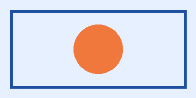

# 1. 서론

이 문서는 **굵게**, *기울임*, ~~취소선~~, 그리고 `코드` 글자를 포함합니다. 한글과 English가 섞인 문단입니다.[^1]

## 1.1 수식

인라인 수식 $E = mc^2$ 와 $\alpha + \beta \le \gamma$, 분수 $\frac{a+b}{c}$ 를 넣었습니다.

$$x = \frac{-b \pm \sqrt{b^2 - 4ac}}{2a}$$

$$\int_0^{\infty} e^{-x^2}\,dx = \frac{\sqrt{\pi}}{2}$$

$$\sum_{k=1}^{n} k^2 = \frac{n(n+1)(2n+1)}{6}$$

$$\lim_{x \to 0} \frac{\sin x}{x} = 1$$

$$A = \begin{pmatrix} 1 & 2 \\ 3 & 4 \end{pmatrix}, \quad \det(A) = -2$$

$$f(x) = \begin{cases} x^2 & x \ge 0 \\ -x & x < 0 \end{cases}$$

$$\sqrt[3]{8} = 2, \quad \hat{x} + \bar{y} + \vec{v}, \quad x_{i}^{2} + \left[ \frac{1}{2} \right]$$

$$\nabla \cdot \mathbf{E} = \frac{\rho}{\varepsilon_0}, \quad \forall x \in \mathbb{R}, \; x \ne 0 \Rightarrow x^2 > 0$$

## 1.2 목록

- 첫 번째 글머리표
- 두 번째 글머리표
    - 안쪽 항목
- 세 번째

1. 번호 하나
2. 번호 둘
    a. 하위 가
    b. 하위 나
3. 번호 셋

## 1.3 표

| 항목 | 값 | 설명 |
|:-----|---:|:----:|
| 사과 | 1,200 | 빨간 과일 |
| 바나나 | 800 | 노란 과일 |

## 1.4 그림

{width=8cm}

[^1]: 이것은 각주입니다. 수식 $a^2+b^2=c^2$ 도 들어 있습니다.
